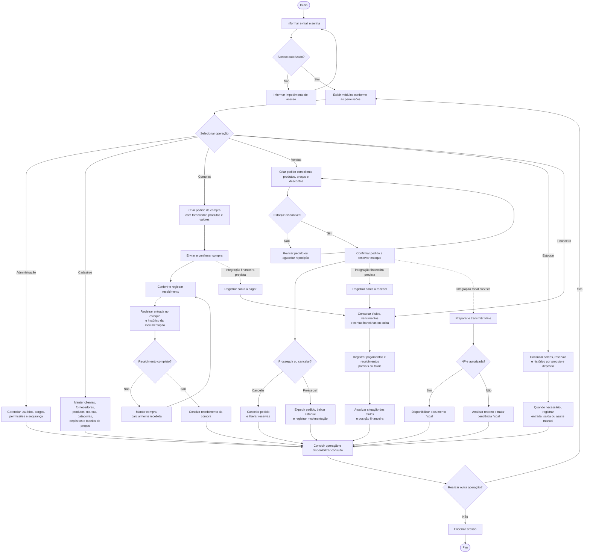

# Fluxograma geral do ERP Distribuidora

O fluxograma apresenta a operação prevista do sistema completo, desde o acesso até os processos de compras, vendas, estoque, financeiro e emissão fiscal. Financeiro e fiscal estão previstos no schema; suas ligações representam a visão funcional de integração, sem afirmar que já estejam implementadas ou definir o momento exato de geração dos títulos.

## Leitura do fluxo

- Retângulos representam atividades; losangos representam decisões; formas arredondadas indicam início e fim.
- Linhas pontilhadas representam integrações previstas para o sistema completo. O momento de criação dos títulos e as condições fiscais para expedição dependem das regras finais desses módulos.
- A confirmação de uma venda reserva o estoque. A expedição realiza a baixa física; o cancelamento anterior à expedição libera a reserva.
- O recebimento de compras pode ocorrer em partes. Cada recebimento registra a entrada correspondente no estoque.
- A expedição e a autorização de NF-e são operações distintas. O status comercial do pedido não comprova autorização fiscal.
- As operações dependem das permissões do usuário e das validações de cada módulo. O desenho resume os caminhos principais e não detalha todas as exceções, cancelamentos ou recuperações de acesso.
